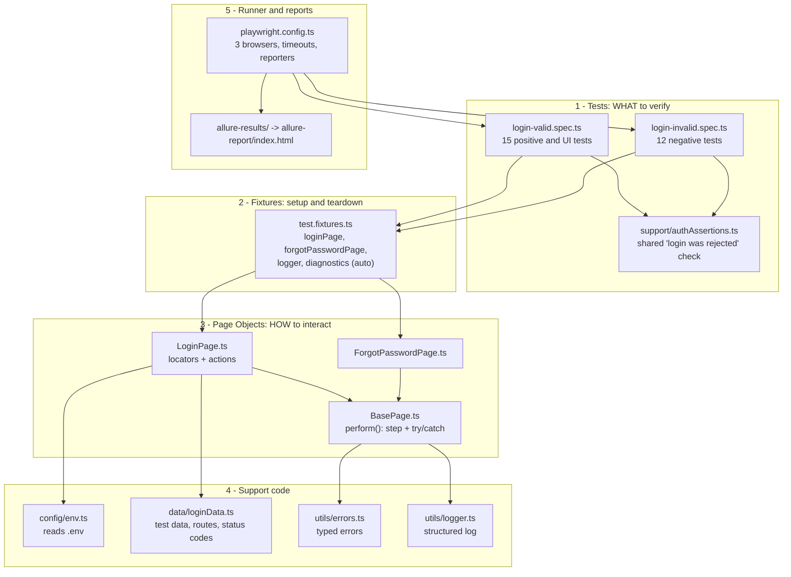
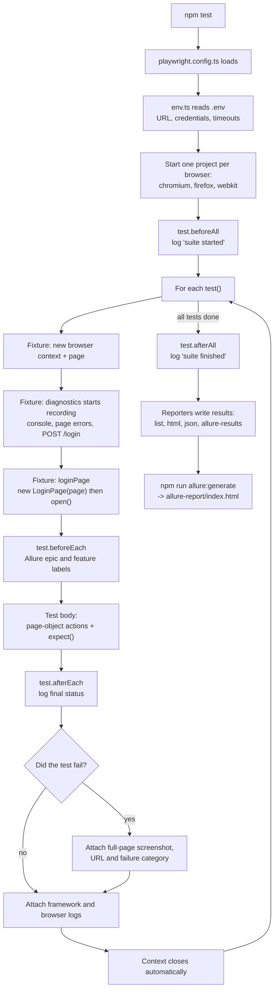
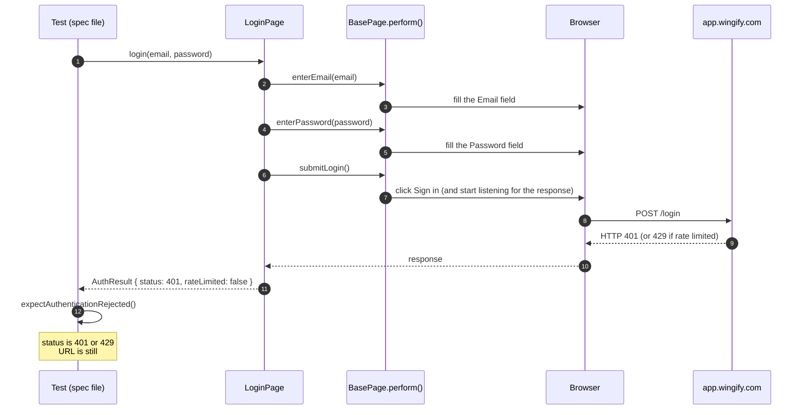
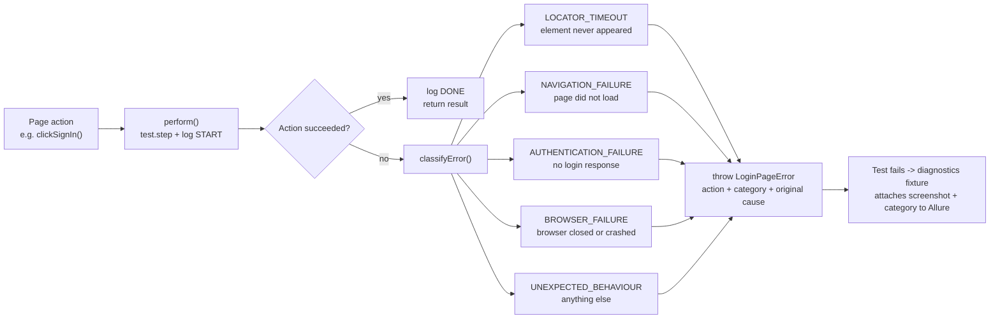
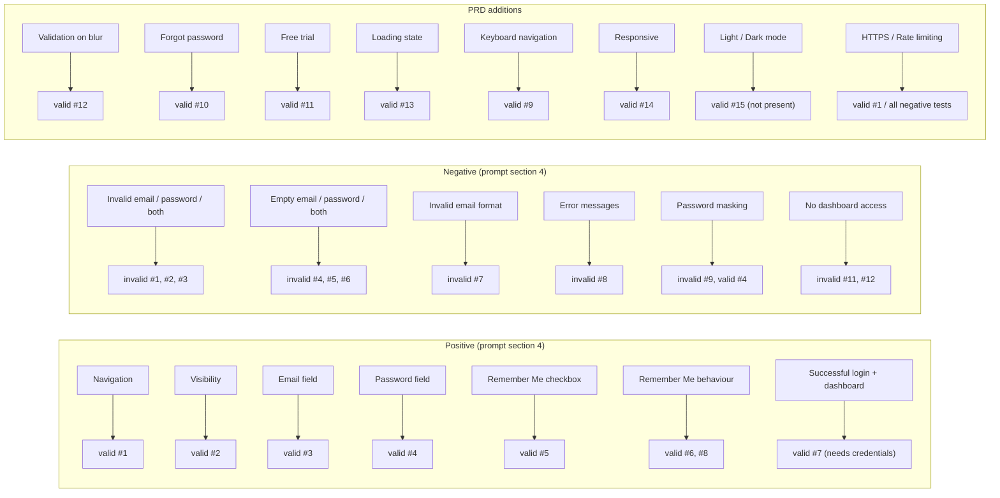

# Framework Guide — How the VWO Login Framework Works

This guide explains how the code is organised, what happens when you run a test,
and which test covers which login feature. Read it alongside the code: every
file and test below is a clickable link.

> **Viewing the diagrams:** they are written in Mermaid. They render on GitHub
> and in VS Code's Markdown preview (`Ctrl+Shift+V`). If VS Code shows them as
> code, install the *Markdown Preview Mermaid Support* extension.

---

## 1. The big picture — five layers

Each layer only talks to the layer below it. Tests never touch raw locators,
and page objects never contain assertions.

| Layer | Files | Job |
| --- | --- | --- |
| Tests | [login-valid.spec.ts](tests/login-valid.spec.ts), [login-invalid.spec.ts](tests/login-invalid.spec.ts), [authAssertions.ts](tests/support/authAssertions.ts) | Describe the scenario and hold **all assertions** (`expect`) |
| Fixtures | [test.fixtures.ts](src/fixtures/test.fixtures.ts) | Create page objects, open the login page, collect logs and screenshots |
| Page Objects | [LoginPage.ts](src/pages/LoginPage.ts), [ForgotPasswordPage.ts](src/pages/ForgotPasswordPage.ts), [BasePage.ts](src/pages/BasePage.ts) | Hold **all locators** and reusable actions (click, fill, submit) |
| Support | [env.ts](src/config/env.ts), [loginData.ts](src/data/loginData.ts), [errors.ts](src/utils/errors.ts), [logger.ts](src/utils/logger.ts) | Configuration, test data, error types, logging |
| Runner | [playwright.config.ts](playwright.config.ts), [allurerc.mjs](allurerc.mjs) | Browsers, timeouts, reporters, Allure report settings |

---

## 2. What happens when you run `npm test`

### TestNG equivalents used

| TestNG | Playwright (this framework) | Where |
| --- | --- | --- |
| `@BeforeSuite` / `@BeforeClass` | `test.beforeAll()` | [valid L10](tests/login-valid.spec.ts#L10), [invalid L8](tests/login-invalid.spec.ts#L8) |
| `@BeforeMethod` | `test.beforeEach()` + the `loginPage` fixture | [valid L14](tests/login-valid.spec.ts#L14), [fixtures](src/fixtures/test.fixtures.ts) |
| `@Test` | `test()` | every scenario |
| `@AfterMethod` | `test.afterEach()` + the `diagnostics` fixture | [valid L19](tests/login-valid.spec.ts#L19), [invalid L17](tests/login-invalid.spec.ts#L17) |
| `@AfterClass` / `@AfterSuite` | `test.afterAll()` | [valid L23](tests/login-valid.spec.ts#L23), [invalid L21](tests/login-invalid.spec.ts#L21) |
| `Assert.assertEquals` | `expect(...)` (web-first: it waits and retries) | inside every test |

---

## 3. Inside one test — a negative login, step by step

Example: [should reject login with an unregistered email](tests/login-invalid.spec.ts#L25).

The key idea: the **page object returns facts** (`AuthResult`), and the **test
decides** whether those facts are correct.

---

## 4. Exception handling — what happens when an action fails

Every page action runs through
[`BasePage.perform()`](src/pages/BasePage.ts). It wraps the action in a
reported step and a `try/catch`.

So when a test fails, the Allure report tells you *which action* failed,
*what kind* of failure it was, and shows a screenshot of the page at that moment.

---

## 5. The LoginPage — locators and actions

### Locators (how each element is found)

The live page keeps four views in the DOM at once (login, forgot password, SSO,
reset password) that share the same labels. So every login control is searched
**inside the login form only**.

| Element | Locator | Why this strategy |
| --- | --- | --- |
| Login form (container) | XPath `//form[@id="js-login-form"]` | Form has no accessible name; XPath fallback |
| Email | `getByRole('textbox', { name: 'Email address' })` | Accessible role + label |
| Password | `getByRole('textbox', { name: 'Password', exact: true })` | Accessible role + label |
| Show/hide password | `getByRole('button', { name: 'Toggle password visibility' })` | Has an aria-label |
| Forgot Password? | `getByRole('button', { name: 'Forgot Password?' })` | Button text |
| Remember Me (state) | `getByLabel('Remember me')` | The real checkbox is hidden; read it through its label |
| Remember Me (click) | `getByText('Remember me', { exact: true })` | Click the visible label, like a user |
| Sign in | `getByRole('button', { name: 'Sign in', exact: true })` | `exact` avoids "Sign in with Google" |
| Loading spinner | XPath `.//span[contains(@class,"loader")]` inside Sign in | No role or label; XPath fallback |
| Start a FREE TRIAL | `getByRole('link', { name: 'Start a FREE TRIAL' })` | Link text |
| Error message | XPath `//*[@id="js-notification-box-msg"]` | No role or label; XPath fallback |

### Actions (reusable methods)

| Method | What it does |
| --- | --- |
| [`open()`](src/pages/LoginPage.ts#L53) | Go to the login URL and wait until the Email field is visible |
| [`enterEmail()`](src/pages/LoginPage.ts#L67) / [`enterPassword()`](src/pages/LoginPage.ts#L71) | Type into the fields |
| [`setRememberMe(true/false)`](src/pages/LoginPage.ts#L75) | Tick or untick Remember Me (only clicks if the state needs to change) |
| [`clickSignIn()`](src/pages/LoginPage.ts#L85) | Click Sign in without waiting for the server |
| [`submitLogin()`](src/pages/LoginPage.ts#L90) | Click Sign in **and** wait for `POST /login`; returns the HTTP status |
| [`submitLoginWithEnterKey()`](src/pages/LoginPage.ts#L102) | Same, but presses Enter in the password field |
| [`login(email, pw, { rememberMe })`](src/pages/LoginPage.ts#L113) | Fill both fields, optional Remember Me, submit — the one-line login |
| [`getValidationMessage()`](src/pages/LoginPage.ts#L121) | Wait for the error box and return its text |
| [`togglePasswordVisibility()`](src/pages/LoginPage.ts#L128) | Click the eye icon |
| [`isEmailFormatValid()`](src/pages/LoginPage.ts#L133) | Ask the browser whether the email field holds a valid email |
| [`blurEmailField()`](src/pages/LoginPage.ts#L139) | Press Tab to leave the email field |
| [`openForgotPassword()`](src/pages/LoginPage.ts#L143) | Click Forgot Password? |
| [`openFreeTrial()`](src/pages/LoginPage.ts#L148) | Click the Free Trial link and return the new tab |
| [`holdNextAuthRequest()`](src/pages/LoginPage.ts#L164) | Pause the next login request so the spinner can be checked, then release it |

---

## 6. Which test covers which functionality

### 6.1 Positive and UI tests — [login-valid.spec.ts](tests/login-valid.spec.ts)

| # | Functionality (from prompt / PRD) | Test | What it checks | Result |
| --- | --- | --- | --- | --- |
| 1 | Login page navigation, HTTPS enforcement | [should navigate to the login page over HTTPS](tests/login-valid.spec.ts#L27) | URL is `#/login`, protocol is `https:`, title, `http://` redirects to `https://` | Pass |
| 2 | Login page visibility | [should display all login page elements](tests/login-valid.spec.ts#L41) | Email, Password, Remember Me, Sign in, Forgot Password, Free Trial are visible | Pass |
| 3 | Email field functionality, auto-focus | [should auto-focus and accept input in the email field](tests/login-valid.spec.ts#L55) | Field is focused on load, `type="email"`, accepts and clears text | Pass |
| 4 | Password field functionality, masking | [should mask the password and toggle its visibility](tests/login-valid.spec.ts#L71) | Masked by default, eye icon shows and re-hides it | Pass |
| 5 | Remember Me checkbox | [should check and uncheck the Remember Me checkbox](tests/login-valid.spec.ts#L87) | Unchecked by default, can be checked and unchecked | Pass |
| 6 | Remember Me selection behaviour | [should keep the Remember Me selection while the form is filled](tests/login-valid.spec.ts#L99) | Stays ticked while you type and toggle the password | Pass |
| 7 | Successful login, dashboard navigation | [should log in with valid credentials and land on the dashboard](tests/login-valid.spec.ts#L110) | Valid login goes to `#/dashboard` | **Skipped** until `VALID_EMAIL`/`VALID_PASSWORD` are set |
| 8 | Remember Me with a real session | [should keep the session in a new tab when Remember Me is selected](tests/login-valid.spec.ts#L122) | A second tab opens the dashboard without logging in again | **Skipped** until credentials are set |
| 9 | Keyboard navigation | [should support keyboard navigation through the login form](tests/login-valid.spec.ts#L140) | Tab order: Email → Password → eye icon → Forgot Password → Sign in | Pass (notes that Remember Me is not reachable by Tab) |
| 10 | Forgot password navigation | [should open Forgot Password and return to login](tests/login-valid.spec.ts#L162) | Goes to `#/forgot-password`, email carried over, Back returns to login | Pass |
| 11 | Free trial registration navigation | [should open free trial registration in a new tab](tests/login-valid.spec.ts#L179) | Link opens a new tab on the free-trial page | Pass |
| 12 | Field validation on blur | [should flag a malformed email when the field loses focus](tests/login-valid.spec.ts#L195) | After Tab, `plainaddress` is invalid and a real email is valid | Pass (notes: no visible inline message) |
| 13 | Loading state during authentication | [should show a loading indicator while authenticating](tests/login-valid.spec.ts#L213) | Spinner appears while the login request is in flight and disappears after | Pass |
| 14 | Responsive login page | [should keep the login form usable on a mobile viewport](tests/login-valid.spec.ts#L233) | At 390px wide, the fields and button are visible and fit the screen | Pass |
| 15 | Light and Dark mode | [should offer Light and Dark mode options if available](tests/login-valid.spec.ts#L249) | Looks for a theme control | **Skipped** — not on the live page |

### 6.2 Negative tests — [login-invalid.spec.ts](tests/login-invalid.spec.ts)

All of these (except 9 and 12) use the shared check
[`expectAuthenticationRejected()`](tests/support/authAssertions.ts): status is
401 or 429, the user stays on `#/login`, and on 401 the error text is
*"Your email, password, IP address or location did not match"*.

| # | Functionality (from prompt / PRD) | Test | Input | Result |
| --- | --- | --- | --- | --- |
| 1 | Login with invalid email | [should reject login with an unregistered email](tests/login-invalid.spec.ts#L25) | Unknown email + any password | Pass |
| 2 | Login with invalid password | [should reject login with an invalid password](tests/login-invalid.spec.ts#L34) | `VALID_EMAIL` (if set) + wrong password | Pass (notes missing test data if no `VALID_EMAIL`) |
| 3 | Both credentials invalid | [should reject login when both credentials are invalid](tests/login-invalid.spec.ts#L49) | Unknown email + wrong password | Pass |
| 4 | Empty email | [should reject submission with an empty email](tests/login-invalid.spec.ts#L57) | `""` + password | Pass |
| 5 | Empty password | [should reject submission with an empty password](tests/login-invalid.spec.ts#L66) | Email + `""` | Pass |
| 6 | Both fields empty | [should reject submission with both fields empty](tests/login-invalid.spec.ts#L74) | Nothing typed | Pass |
| 7 | Invalid email format | [should flag and reject malformed email formats](tests/login-invalid.spec.ts#L84) | `plainaddress`, `user@`, `@example.com`, `user@@example.com` | Pass |
| 8 | Authentication error message | [should display the verified authentication error message](tests/login-invalid.spec.ts#L102) | Wrong credentials; checks the exact error text | Pass |
| 9 | Password masking | [should keep the password masked and not leak it into page text](tests/login-invalid.spec.ts#L116) | Password stays `type="password"` and never appears as page text | Pass |
| 10 | Authentication failure handling | [should reject login submitted with the Enter key](tests/login-invalid.spec.ts#L125) | Submit with Enter instead of clicking | Pass |
| 11 | No dashboard access after failure | [should not grant dashboard access after a failed login](tests/login-invalid.spec.ts#L135) | Failed login, then open `#/dashboard` → sent back to login | Pass |
| 12 | No dashboard access, fresh session | [should redirect an unauthenticated fresh context away from the dashboard](tests/login-invalid.spec.ts#L148) | Brand-new browser context opens `#/dashboard` → sent back to login | Pass |

### 6.3 Coverage map — prompt requirement to test

---

## 7. Where to look when you want to…

| I want to… | Go to |
| --- | --- |
| Change the URL, credentials or timeouts | `.env` (copy from [.env.example](.env.example)), read by [env.ts](src/config/env.ts) |
| Fix a broken locator | The constructor of [LoginPage.ts](src/pages/LoginPage.ts#L34) |
| Add a new page action | [LoginPage.ts](src/pages/LoginPage.ts) — wrap it in `this.perform(...)` |
| Add a new test | [login-valid.spec.ts](tests/login-valid.spec.ts) or [login-invalid.spec.ts](tests/login-invalid.spec.ts) — use the `loginPage` fixture |
| Change test data or expected error text | [loginData.ts](src/data/loginData.ts) |
| Change browsers, reporters or screenshot settings | [playwright.config.ts](playwright.config.ts) |
| Change what is attached to the report | The `diagnostics` fixture in [test.fixtures.ts](src/fixtures/test.fixtures.ts) |
| Run the tests and see the report | Commands in [README.md](README.md#4-execution-commands) |
