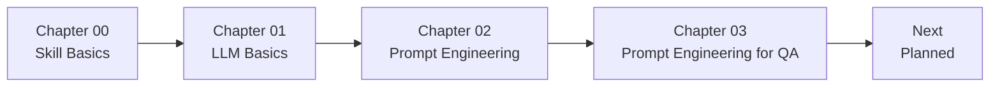
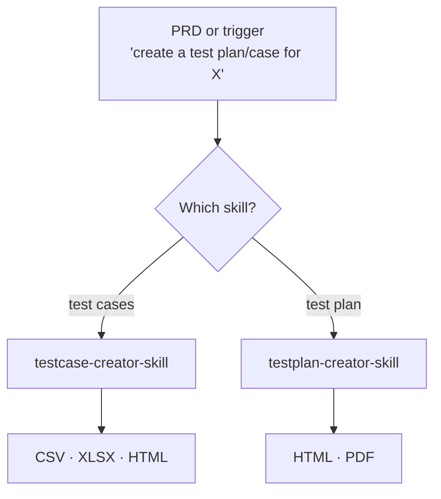
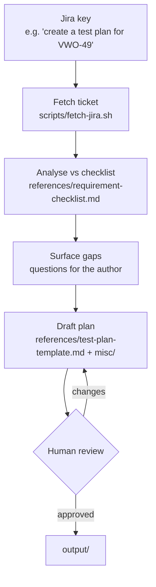
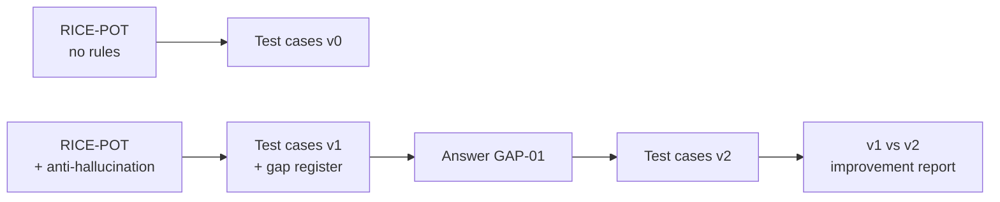
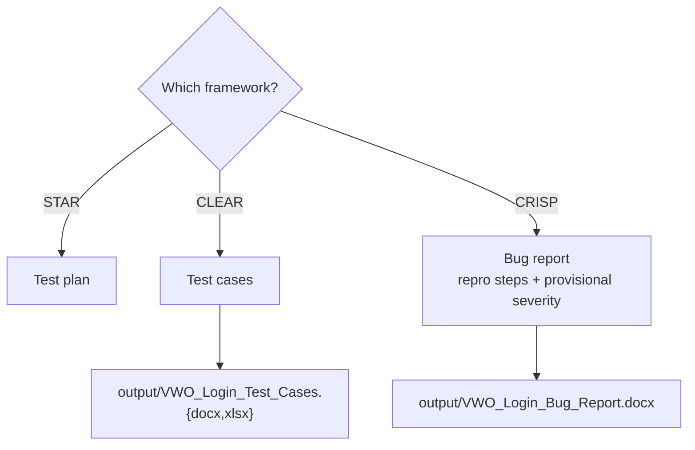

# AI Tester Blueprint 5x

A hands-on learning repository for building AI-assisted QA workflows. It starts with authoring reusable skills, moves through LLM fundamentals and prompt engineering, and then applies QA prompt frameworks to everyday deliverables. Along the way it keeps the artifacts those skills and prompts produced: test plans, test cases, bug reports and two generated automation frameworks (Selenium + Java and Playwright + TypeScript).

## Roadmap

The repository is a staged path: **author skills → understand the models → engineer the prompts → apply prompt frameworks to QA deliverables**.



| Stage | Chapter | Focus | Status |
|-------|---------|-------|--------|
| 1 | Chapter 00 — Skill Basics | Reusable skills that generate test plans and test cases from a PRD or a Jira ticket | ✅ Done |
| 2 | Chapter 01 — LLM Basics | Self-study guide to LLM fundamentals for testers | ✅ Done |
| 3 | Chapter 02 — Prompt Engineering | RICE-POT prompts with anti-hallucination rules: test cases, gap analysis, and generated Selenium / Playwright frameworks | ✅ Done |
| 4 | Chapter 03 — Prompt Engineering for QA | STAR / CLEAR / CRISP prompts: test plan, test cases, bug report | ✅ Done |
| 5 | Next | AI agents and further chapters | 🔜 Planned |

## Repository Structure

```
AITesterBlueprint5x/
├── Chapter_00_SKILL_Basics/              # Authoring and using skills
│   ├── 00_Basic_Skills/                  # PRD-driven skills
│   │   ├── testcase-creator-skill/       # testcases_skills.md: test cases from a PRD
│   │   └── testplan-creator-skill/       # SKILLS.md: test plan from a PRD, plus sample output/
│   ├── 01_Advanced_Skills/
│   │   └── testplan-creator-skill_a/     # Jira-driven test plan (fetch → gap analysis → review gate)
│   │       ├── SKILL.md
│   │       ├── references/               # requirement-checklist.md + test-plan-template.md
│   │       ├── scripts/                  # fetch-jira.{sh,py}: pull a ticket over the Jira REST API
│   │       └── misc/                     # Company details, logo, Figma design
│   ├── output/                           # VWO-49 test plan (HTML, MD) + test cases (HTML, XLSX, CSV)
│   ├── resources/                        # Source ticket (VWO-49.doc)
│   └── MyNotes.md                        # Prompts used to drive the skills
├── Chapter_01_LLM_Basics/
│   └── LLM_Fundamentals_from_Scratch.html  # Interactive guide: lessons, exercises, glossary
├── Chapter_02_Prompt_Engineering/        # RICE-POT prompt framework
│   ├── Template_RICE_POT/                # Blank RICE-POT prompt template
│   ├── RICEPOT_Template_with_anti-hallucination.md
│   ├── RICEPOT_Template_without_hallucination.md
│   ├── anti-hallucination-rules.md       # Guardrails reused across prompts
│   ├── REALPROMPT_RICE_POT.md            # Filled prompt → Selenium + Java (Salesforce login)
│   ├── REAL_RICE_POT_PW.md               # Filled prompt → Playwright + TypeScript (VWO login)
│   ├── SeleniumFramework/                # Generated Maven / TestNG / Allure project
│   ├── PlaywrightFramework/              # Generated Playwright / TypeScript / Allure project
│   ├── output/                           # Test cases (XLSX) + gap analysis and v1-vs-v2 reports (HTML)
│   ├── resources/                        # VWO Login Dashboard PRD (PDF)
│   └── MyNotes.md                        # Prompt run log
├── Chapter_03_Prompt_Engineering_QA/     # QA prompt frameworks
│   ├── STAR.md                           # STAR prompt → VWO login functional test plan
│   ├── CLEAR.md                          # CLEAR prompt → VWO login test cases
│   ├── CRISP.md                          # CRISP prompt → VWO login bug report
│   ├── TestPlanTemlate.md                # Test-plan template referenced by the prompts
│   └── output/                           # Generated DOCX / XLSX deliverables
├── learnings/                            # Dated learning journal (see Agents.md)
└── Agents.md                             # Rules for the automatic learning journal
```

## Chapter 00 — Skill Basics

Skills are reusable instruction modules that the agent loads on demand. Each lives in its own folder with a Markdown file that declares frontmatter (`name`, `description`, `version`, `author`, `license`, `tags`), followed by the instructions the agent follows.

### Basic skills: `Chapter_00_SKILL_Basics/00_Basic_Skills/`



#### `testcase-creator-skill`

Creates test cases from a PRD or a direct trigger such as *"create a test case for X"*, using the VWO.com template.

Output columns: `Scenario_TID`, `TestCase Description`, `PreCondition`, `TestSteps`, `Expected Result`, `Actual Result`, `Steps to Execute`, `Expected Result`, `Actual Result`, `Status`, `Executed QA Name`, `Misc (Comments)`, `Priority`, `Is_Automated`.

Deliverables: CSV, XLSX and HTML.

#### `testplan-creator-skill`

A QA-strategist skill built on risk-driven prioritisation, requirements traceability and coverage completeness. It produces a plan with overview, scope, strategy, test types and levels, entry/exit criteria, environment, test data, risk analysis, schedule, coverage matrix and deliverables. A sample VWO Login Dashboard plan (HTML + PDF) sits in its `output/` folder.

### Advanced skill: `01_Advanced_Skills/testplan-creator-skill_a/`

#### `advance-testplan-creator`

Turns a **Jira ticket** into a test plan that a human still has to approve. It follows a fixed workflow:

1. **Fetch the ticket.** `scripts/fetch-jira.sh` (or `.py`) pulls the issue over the Jira REST API. If the fetch fails, the skill asks for the ticket body instead of inventing it.
2. **Analyse against the checklist.** Each item in `references/requirement-checklist.md` is marked ✅ present, ⚠️ ambiguous or ❌ missing.
3. **Surface the gaps.** Missing acceptance criteria, edge cases, non-functional needs, test data and ambiguous wording are listed as questions for the author.
4. **Draft the plan.** The skill fills `references/test-plan-template.md`, using the company details and logo from `misc/`.
5. **Stop for human review.** The plan is never marked final.



### Generated artifacts: `Chapter_00_SKILL_Basics/output/`

- **VWO-49 Passkey & SSO Login: test plan** in HTML and Markdown.
- **VWO-49 Passkey & SSO Login: test cases** in HTML, XLSX and CSV.

## Chapter 01 — LLM Basics

`Chapter_01_LLM_Basics/LLM_Fundamentals_from_Scratch.html` is a self-contained study guide for QA testers who are new to AI:

- **13 lessons in plain words.** They cover the AI family tree, next-token prediction, tokens, foundation models, prompting, temperature, context windows, memory, RAG, MCP, agents, hallucination and how to test LLM output.
- **"Test yourself" checks and hands-on exercises** after every lesson, with answers.
- **A glossary** ("Words made simple"), the 25 words to learn first, and common mix-ups.
- **A one-page summary** of the whole course.

Open the file directly in a browser. It needs no build step or server.

## Chapter 02 — Prompt Engineering

`Chapter_02_Prompt_Engineering/` applies the **RICE-POT** framework (Role · Instructions · Context · Example · Parameters · Output · Tone) in two ways.

### 1. Test cases and the anti-hallucination experiment

`MyNotes.md` records a three-prompt run against the VWO login page:

1. Generate test cases with RICE-POT and the *without hallucination* template.
2. Generate them again with `anti-hallucination-rules.md` and report the gaps found.
3. Supply the missing detail (**GAP-01**: `app.vwo.com` now redirects to `app.wingify.com`), regenerate as v2, and compare the two versions.



The outputs in `output/` are the three XLSX test-case sets, `Gap_Analysis_anti-hallucination.html` and `Test_Case_Improvement_Report_v1_vs_v2.html`.

### 2. Generated automation frameworks

| Prompt | Framework | Stack | Target |
|--------|-----------|-------|--------|
| `REALPROMPT_RICE_POT.md` | `SeleniumFramework/` | Java · Selenium · TestNG · Maven · Allure | Salesforce login |
| `REAL_RICE_POT_PW.md` | `PlaywrightFramework/` | TypeScript · Playwright Test · Allure 3 | VWO / Wingify login |

- **SeleniumFramework**: a Page Object (`LoginPage.java`), `BaseTest`, and valid and invalid login tests. Running `mvn test` also generates the Allure report.
- **PlaywrightFramework**: Page Objects (`BasePage`, `LoginPage`, `ForgotPasswordPage`), fixtures that attach diagnostics on failure, typed errors, structured logging, and runs on Chromium, Firefox and WebKit. Its own `README.md` and `FRAMEWORK_GUIDE.md` describe the design in detail.

## Chapter 03 — Prompt Engineering for QA

`Chapter_03_Prompt_Engineering_QA/` uses three compact frameworks, each suited to a different deliverable.

| Framework | Shape | Used for | Prompt file |
|-----------|-------|----------|-------------|
| **STAR** | Situation · Task · Action · Result | Functional **test plan** | `STAR.md` |
| **CLEAR** | Context · Limits · Examples · Action · Review | **Test cases** with hard limits and P0/P1/P2 priority | `CLEAR.md` |
| **CRISP** | Context · Role · Instructions · Style · Parameters | Reproducible **bug report** | `CRISP.md` |



All three prompts share the same guardrails:

- use only the supplied requirements;
- do not invent password rules, exact error messages or session timeouts;
- use synthetic credentials only;
- mark unspecified behaviour *"Requires clarification"*.

## Learning Journal

`learnings/` holds one dated Markdown file per completed task, in the format defined by `Agents.md`. Each file covers the objective, tools, steps, code, challenges, learnings and verification. Current entries:

- VWO-49 Passkey & SSO test plan and test cases
- VWO login test cases with RICE-POT (no hallucination)
- VWO login test cases with the anti-hallucination gap register
- VWO login test cases v2 after the domain-redirect information

## Core Principles

The skills and prompts in this repository follow the same rules:

1. Use only information provided by the user, or fetched from the linked ticket.
2. Do not invent requirements, validation rules or error text.
3. Never mark a plan "final". A human owns sign-off.
4. Do not put personal data or real credentials in generated output.

## Configuration

The advanced `testplan-creator-skill_a` skill reads Jira credentials from a `.env` file:

```
JIRA_BASE_URL=https://<your-org>.atlassian.net
JIRA_EMAIL=<your-email>
JIRA_API_TOKEN=<your-api-token>
```

The Playwright framework ships `.env.example`. Copy it to `.env` and fill in your own values.

> **Security:** never commit a `.env` file. If a token has ever been pushed, rotate it.

## Usage

**Skills (Chapter 00).** Reference the skill and give it the input:

```
@Chapter_00_SKILL_Basics/01_Advanced_Skills/testplan-creator-skill_a/SKILL.md
create a test plan for VWO-49
```

For the basic skills, paste a PRD or say *"create a test plan / test case for X"*.

**Prompt frameworks (Chapter 02/03).** Reference the prompt file and state the output format:

```
@Chapter_03_Prompt_Engineering_QA/CLEAR.md use this prompt and give me the
output in docx in the Chapter_03_Prompt_Engineering_QA/output folder
```

**Selenium framework:**

```bash
cd Chapter_02_Prompt_Engineering/SeleniumFramework
mvn test
```

**Playwright framework:**

```bash
cd Chapter_02_Prompt_Engineering/PlaywrightFramework
npm install
npx playwright install
npm test                 # or npm run test:chromium / test:headed
npm run allure:serve     # build and open the Allure report
```

## Author

Chaitanya Hasabnis

## License

MIT
