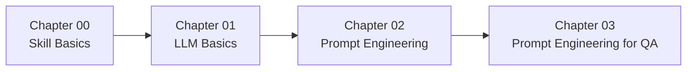

# Generate Repository README

## Date
2026-11-21

## Objective
Write a root `README.md` for AITesterBlueprint5x, using the structure of a reference README from another course repository, so the repository has a clear overview of its chapters, skills, prompts and generated artifacts.

## Tools and Technologies Used
- Claude Code (file reading, git file listing)
- Markdown with Mermaid flowcharts

## Steps Performed
1. Read the reference README to get its section layout: roadmap, structure tree, per-chapter sections, learning journal, principles, configuration, usage, author and license.
2. Listed the tracked files with `git ls-files` to get the real structure of this repository.
3. Read the skill files, prompt files, `MyNotes.md` files, the Playwright framework README and `package.json`, and the Selenium `pom.xml`.
4. Extracted the section headings from `LLM_Fundamentals_from_Scratch.html` to describe the guide accurately.
5. Wrote `README.md`, covering only chapters 00–03, which are the ones that exist in this repository.

## Code Examples

## Challenges Faced
- The reference README describes chapters, files and deployments that don't exist here (Chapters 04–05, n8n agents, the context packs).
- Some file names differ from the reference (for example `REAL_RICE_POT_PW.md`, `TestPlanTemlate.md` and `Agents.md`).

## Solutions Implemented
- Kept the reference layout but took every file name and feature from this repository's own files.
- Left out unverified counts and features, and described what is planned only as "Next / Planned".

## Key Learnings
- A reference README is a template for structure, not for content. Every claim has to be checked against the files.
- `git ls-files` gives a cleaner structure map than a raw directory listing, because it skips `node_modules` and build output.

## Testing and Verification
- Checked the file and folder names in the README against `git ls-files` output.
- The Mermaid diagrams were not rendered locally. Check them on GitHub after pushing.

## Future Improvements
- Fix the `.gitignore` entries `.env,` and `Thumbs.db,`. The trailing commas stop them from matching the real files.
- Update the README as new chapters are added.
